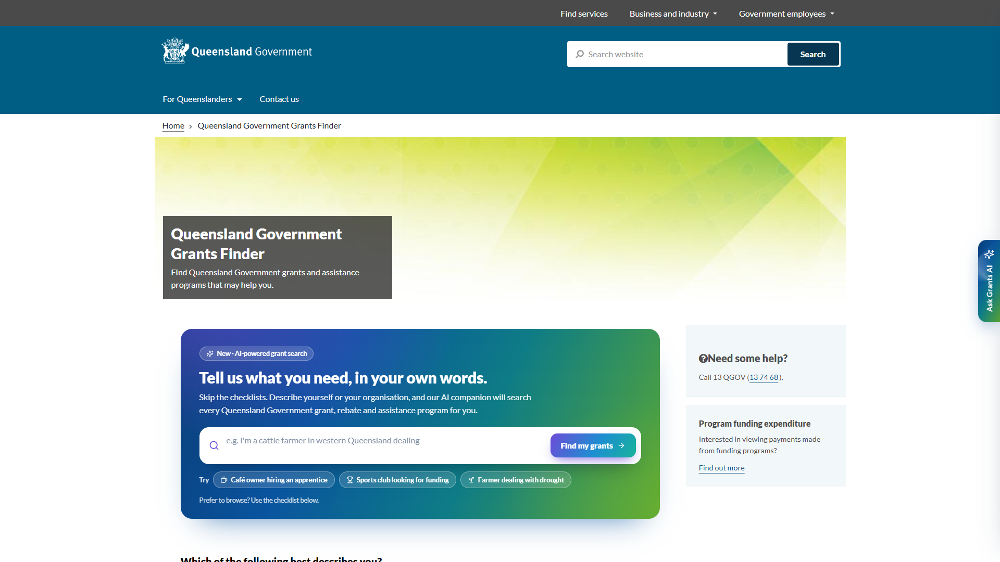
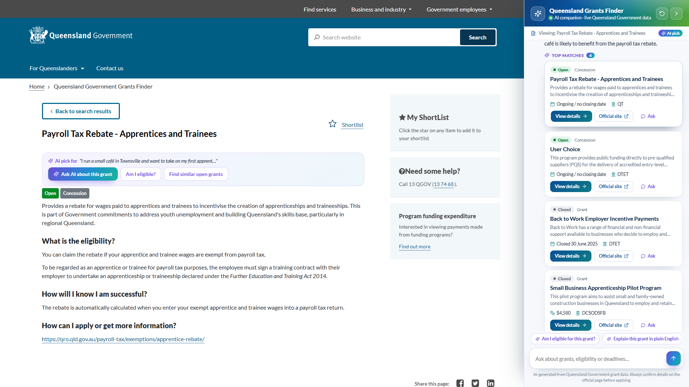
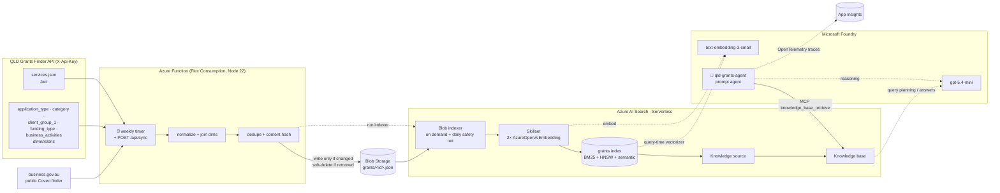

# Grants Finder AI Companion

**Describe what you need. Discover support that fits. Keep the conversation as you explore.**

Finding a grant should not start with knowing its name, the agency that runs it, or the right boxes to tick. This project explores a different front door to government support: a conversational companion that helps people discover relevant programs, understand the requirements and follow the official links.

Built with **Microsoft Foundry**, **FoundryIQ** and **Azure AI Search**, it brings together Queensland Grants Finder and [business.gov.au](https://business.gov.au/Grants-and-Programs) listings, with Queensland as the default starting point.

**[Explore the journey](demo/grants-finder-extension/JOURNEY.md)** · **[Run the demo](demo/grants-finder-extension/README.md#run-it)** · **[Architecture](#architecture)** · **[Deploy](#deploy)** · **[Query the index](#querying)** · **[Grants agent](#grants-agent)**

> **Independent proof of concept, not an official government service.** The screenshots show a locally installed browser extension layered onto the public Queensland Government Grants Finder, not a change to the live website for other visitors. This is a demonstration of the experience, not a production-ready public service or an eligibility decision.



## The vision: start with a person, not a program name

Meet **Mia, a small cafe owner in Townsville**. Business is picking up and she wants to hire her first apprentice. She has heard there is government support, but does not know where to begin.

> "I run a small cafe in Townsville and want to take on my first apprentice. What support can I get?"

Instead of translating her situation into a set of filters, Mia starts with that question. The companion searches the grants knowledge base, explains the options and stays beside her as she opens a program's details. The original filters and browsing experience remain available throughout.

| From | To |
|---|---|
| Guessing program names and applicant categories | Describing a goal in everyday language |
| Opening results one by one to work out relevance | A shortlist with status, dates, source links and known requirements |
| Losing the thread between search and detail pages | A conversation that follows the journey |
| Interpreting eligibility text alone | Asking follow-up questions about the program being viewed |
| Comparing programs across tabs | Asking what to explore first, with reasons and caveats |

### One conversation, from discovery to next steps

| Moment | What the demo shows |
|---|---|
| **Ask** | An inline AI search above the existing checklist, with starter prompts to make the first question easier. |
| **Explore** | A docked companion, visible search progress, grounded answers and actionable grant cards. The page reflows beside the panel rather than disappearing behind a chat bubble. |
| **Understand** | A program detail page with contextual follow-ups such as "Am I eligible?" and "Find similar open grants", without restarting the conversation. |
| **Compare** | AI-pick highlights in the site's results and a follow-up that compares the recommended programs for Mia's situation. |
| **Keep browsing** | Collapse the companion to an edge tab, use the classic filters, and return to the conversation when needed. |



**[See the complete 12-step journey with 16:9 screenshots →](demo/grants-finder-extension/JOURNEY.md)**

The walkthrough captures real agent responses from the Queensland-only version of the index. The pipeline now also ingests business.gov.au listings; the screenshots are a record of the demo, not a statement of current program availability.

### Assistance, not an eligibility verdict

The aim is to help people find and understand support, not to promise funding or make decisions on their behalf. The agent is instructed to retrieve before answering, cite sources, state what is unknown and direct people to the official program page. Geographic tags and generated answers are discovery aids; applicants still need to confirm current requirements with the provider.

The broader vision is the same grounded agent wherever someone needs help: embedded natively in a grants site, available in Teams or Microsoft 365 Copilot, or supporting a contact-centre adviser. Those are potential channels, not integrations shipped in this repository.

## What is here today

| Layer | What is implemented | Start here |
|---|---|---|
| **Grants data and search** | Weekly two-source ingestion, deduplication, change tracking, facets, keyword/vector/hybrid search and semantic ranking. | [Querying](#querying) |
| **Grounded grants agent** | A YAML-defined Foundry prompt agent connected to a FoundryIQ knowledge base through MCP, with Application Insights monitoring. | [Grants agent](#grants-agent) |
| **Experience prototype** | A separate Edge/Chrome extension and local authentication bridge demonstrating the journey on the existing public site. It is not deployed by the infrastructure template. | [Demo setup](demo/grants-finder-extension/README.md) |
| **Deployment as code** | Bicep infrastructure, JSON search definitions and scripts to publish the search objects and agent. | [Deploy](#deploy) |

The prototype stays separate from the backend: it calls the published agent through the Foundry Responses API and does not change the ingestion, index or agent deployment. You can use the backend entirely without the extension.

---

## Architecture

A weekly TypeScript Azure Function pulls the [QLD Grants Finder](https://www.grants.services.qld.gov.au/) API **and** the public business.gov.au finder (Coveo). It normalizes and deduplicates each feed, then stages one JSON document per program in Blob Storage. An AI Search **pull indexer** embeds the title and description with a Microsoft Foundry `text-embedding-3-small` deployment. The results go into a faceted `grants` index, which a FoundryIQ **knowledge base** (`gpt-5.4-mini`) is layered over. The **Queensland Grants Finder agent** ([YAML definition](agents/grants-agent.yaml)) calls that knowledge base through MCP.



**Why stage in Blob?** AI Search pull indexers can't call an HTTP endpoint or Function directly. Blob is the simplest supported source. It gives change detection (`LastModified`), soft-delete detection (`IsDeleted` metadata) and a free audit trail of exactly what was indexed.

| Resource | Notes |
|---|---|
| **Azure AI Search** `serverless` (preview), `2026-09-01-preview` | Semantic ranker and agentic retrieval (`knowledgeRetrieval`) enabled, system-assigned MI, Entra ID + key auth |
| **Microsoft Foundry** (AIServices) + project, `2026-09-15-preview` | `text-embedding-3-small` (1536d) and `gpt-5.4-mini` GlobalStandard deployments; project connections to Search (`grants-search`), the knowledge base MCP endpoint (`grants-kb-mcp`, `RemoteTool`, project managed identity) and Application Insights (`appinsights`, agent tracing) |
| **Function App** Flex Consumption, `2026-08-01` | Node 22, system MI, identity-based `AzureWebJobsStorage` |
| **Storage** `2026-09-01` | Shared keys disabled. Containers: `grants` and `app-package` |
| Log Analytics + App Insights | Function telemetry and Foundry agent traces |
| RBAC `2026-07-01-preview` | Keyless everywhere (see [Security](#security)) |

---

## Data model

The API returns a fact table (`services.json`, about 580 records keyed by id) plus five checkbox-style dimension tables. Each grant's `tags` hold ids from all five dimensions, and the id prefix identifies the dimension:

| Tag prefix | Dimension endpoint | Index field |
|---|---|---|
| `1xxx` | `application_type` | `applicantTypes` |
| `2xxx` | `category` | `categories` |
| `3xxx` | `client_group_1` | `clientGroups` |
| `4xxx` | `funding_type` | `fundingTypes` |
| `5xxx` | `business_activities` | `businessActivities` |

Lookups use the dimension tables, so new dimension values are picked up automatically. "Select all" options (negative keys) are ignored.

**business.gov.au** uses a public Coveo search endpoint. The sync reads the finder page's published search key and query scope at run time; neither is stored or committed. It pages through all listing results and rejects incomplete snapshots before touching Blob Storage. This feed includes nationwide **and** state-specific programs; hosting on business.gov.au does not prove federal administration. The index retains each program's `jurisdictions` (the upstream `cloc` location facet) and `source` so a Queensland default can coexist with explicit other-state searches. Eligibility HTML is normalized to plain text, URLs use the public `/grants-and-programs/...` route, and date-only closing dates are treated as the *end* of the displayed Australian day. Agency and dollar amount are null when the feed doesn't provide structured values. Live counts change with the publisher's data.

### Index `grants`

| Field | Type | S | F | Fa | So | Source / notes |
|---|---|:-:|:-:|:-:|:-:|---|
| `id` | key | | ✓ | | | upstream id (lowest id when duplicates are merged) |
| `source`, `jurisdictions` | string, string[] | ✓ | ✓ | ✓ | | provenance and geographic applicability; business.gov.au IDs are prefixed `bga-` |
| `title` | string | ✓ | | | ✓ | `"{sub_program_title} – {name}"`, because many records are named only "Round 1" |
| `programName`, `roundName` | string | ✓ | ✓ | ✓ | ✓ | |
| `summary` | string | ✓ | | | | `grant_summary` (the "description") |
| `eligibility`, `howToApply`, `successNotification` | string | ✓ | | | | |
| `status` | string | | ✓ | ✓ | | `Open` / `Closed` |
| `isOpen` | bool | | ✓ | ✓ | | Open **and** closing date not passed *at sync time* |
| `openingDate`, `closingDate` | DateTimeOffset | | ✓ | ✓ | ✓ | parsed from 6 mixed formats, QLD time (+10:00) |
| `amount` | double | | ✓ | ✓ | ✓ | |
| `issuingAgency`, `deliveredBy`, `assistanceType`, `financialYearBudget` | string | ✓ | ✓ | ✓ | | |
| `applicantTypes`, `categories`, `clientGroups`, `fundingTypes`, `businessActivities` | string[] | ✓ | ✓ | ✓ | | joined from the dimensions |
| `url` | string | | | | | |
| `tagIds`, `sourceIds`, `contentHash`, `lastChangedAt` | – | | ✓ | | | lineage and change tracking |
| `titleVector`, `descriptionVector` | 1536 × single | ✓ | | | | HNSW (cosine), Foundry vectorizer for query-time embedding |

S = searchable, F = filterable, Fa = facetable, So = sortable. The semantic configuration `grants-semantic` uses `title` as the title field, then `summary`, `eligibility` and `successNotification` as content, and the audience and category collections as keywords. `en.microsoft` analyzers are used throughout.

### Deduplication and updates

1. **Key = source-scoped upstream id.** A QLD grant retains its numeric id (also used in the public QLD site's details route). A business.gov.au listing gets `bga-<Sitecore id>`, preventing collisions and preserving updates.
2. **Identical QLD content → one document.** Each normalized QLD record gets a SHA-256 fingerprint that excludes its id. Records with the same fingerprint are merged into the lowest id, and every original id goes into `sourceIds`. Business.gov.au listings are deduplicated by their stable Sitecore id, keeping the richer record when duplicate variants occur. Separate publishers' listings are not merged by title, since rounds and eligibility can differ.
3. **Only write what changed.** Each blob stores a `contenthash` in its metadata. The sync lists the container once, rewrites only the grants whose hash changed, and leaves everything else alone. The indexer's change detection therefore re-embeds only changed grants, which keeps embedding cost close to zero on quiet weeks.
4. **Removals.** A grant that disappears (or is merged into another id) gets blob metadata `IsDeleted=true`, and the indexer's soft-delete policy removes it from the index. Soft-deleted blobs are purged after 30 days (`SOFT_DELETE_RETENTION_DAYS`).
5. The Function triggers the indexer only when something changed. The indexer also has its own daily schedule as a safety net.

---

## Repository layout

```
infra/                  Bicep: main.bicep (+ .bicepparam) and small modules
  modules/              search · foundry · function · storage · monitoring · roles
src/
  functions/syncGrants.ts   weekly timer + POST /api/sync
  lib/                      qldClient · businessClient · businessGrants · normalize · dates · dedupe · transform · blobStore · searchClient · sync
search/                 JSON definitions (templated with ${VARS}): index, datasource, skillset,
                        indexer, knowledge-source, knowledge-base
agents/                 Foundry agent definitions (YAML, templated with ${VARS}): grants-agent.yaml
scripts/                setup-search.ts · setup-agent.ts · chat.ts · query.ts · preview-grants.ts · env.ts · foundry.ts
test/                   vitest unit tests + small real-data fixtures
demo/                   throwaway demos, self-contained and not deployed
  grants-finder-extension/  Edge/Chrome extension: AI companion on the public Grants Finder (see its JOURNEY.md)
```

---

## Deploy

**Prerequisites:** Azure CLI (with Bicep ≥ 0.47), Node 22, Azure Functions Core Tools v4, a QLD Grants API key, and quota for `text-embedding-3-small` and `gpt-5.4-mini` (GlobalStandard) in the target region.

The region must support the **Serverless** tier, **semantic ranker** and **agentic retrieval**. `australiaeast` (the default) supports all three. See [region support](https://learn.microsoft.com/azure/search/search-region-support).

```powershell
az login
$env:QLD_API_KEY        = '<your X-Api-Key>'
$env:AZURE_PRINCIPAL_ID = az ad signed-in-user show --query id -o tsv   # grants you data-plane roles for the scripts
# $env:STORAGE_POLICY_OPT_OUT = 'true'   # only if an org policy forces storage public network access off (adds tag SecurityControl=Ignore)

# 1. Infrastructure
az group create -n rg-qld-grants -l australiaeast
az deployment group create -g rg-qld-grants -n main -p infra/main.bicepparam

# 2. Function code (ARM returns output names with odd casing, hence functioN_APP_NAME)
npm ci
npm run build
$app = az deployment group show -g rg-qld-grants -n main --query properties.outputs.functioN_APP_NAME.value -o tsv
func azure functionapp publish $app --typescript --no-build

# 3. Search objects (index, data source, skillset, indexer, knowledge source, knowledge base)
#    AZURE_RESOURCE_GROUP pulls the deployment outputs into .env for all later script runs
#    (or: npx tsx scripts/setup-search.ts -g rg-qld-grants to force a refresh)
$env:AZURE_RESOURCE_GROUP = 'rg-qld-grants'
npm run setup:search

# 4. First sync (or wait for the weekly timer)
$key = az functionapp function keys list -g rg-qld-grants -n $app --function-name syncGrants --query default -o tsv
Invoke-RestMethod -Method Post "https://$app.azurewebsites.net/api/sync?code=$key"

# 5. Watch the indexer, then query
npm run query -- status

# 6. Grants agent (Foundry prompt agent from agents/*.yaml), then chat with it
npm run setup:agent
npm run chat
```

> Bicep may warn `BCP081 … does not have types available` for the newest API versions (Bicep's type definitions lag behind ARM). ARM still validates these at deploy time. `az deployment group validate` passes with this template.

### Configuration

| App setting | Default | Purpose |
|---|---|---|
| `QLD_API_KEY` | *(Bicep secure param)* | `X-Api-Key` header for the Grants API |
| `QLD_API_BASE_URL` | `https://api.jus-checklist.services.qld.gov.au/v1/api/legacy/resources/grants` | |
| `SYNC_SCHEDULE` | `0 0 16 * * 6` | NCRONTAB in **UTC**: Sat 16:00 UTC = Sun 02:00 AEST |
| `GRANTS_STORAGE_ACCOUNT_URL` / `GRANTS_CONTAINER` | deployment output / `grants` | staging area |
| `SEARCH_ENDPOINT` / `SEARCH_INDEXER_NAME` | deployment output / `grants-indexer` | indexer run after sync |
| `SOFT_DELETE_RETENTION_DAYS` | `30` | purge soft-deleted blobs after N days |

The indexer's own schedule (`search/indexer.json`) is `P1D`, the longest interval AI Search allows. Blob change detection means runs with no changed blobs process nothing, so the effective cadence is the weekly Function, which triggers the indexer as soon as it writes changes.

---

## Local development

```powershell
npm ci
npm test                        # unit tests (dates, normalization, dedupe, blob sync)
$env:QLD_API_KEY = '<key>'
npm run preview                 # live API -> normalized/deduped docs, no Azure needed
npm run preview -- --out grants.preview.json
```

To run the Function locally, copy `local.settings.sample.json` to `local.settings.json`, start Azurite, then run `npm start`. Blob and Search access use your `az login` identity through `DefaultAzureCredential`.

---

## Querying

`scripts/query.ts` runs ready-made scenarios against the index (Entra ID auth, API `2026-08-01-preview`):

```powershell
npm run query -- status                                           # indexer status + index stats
npm run query -- keyword  "fishing"                               # BM25 only
npm run query -- vector   "help for farmers in financial hardship" # pure vector (title + description)
npm run query -- hybrid   "funding for a community sports club"    # BM25 + vector (RRF) + facets
npm run query -- semantic "I want to export my product overseas"   # hybrid + semantic reranker, captions, answers
npm run query -- facets                                           # facet overview of the whole index
npm run query -- filtered "innovation"                            # open + business applicants + grant/loan + amount ≥ 10k
npm run query -- agentic  "What open grants can a small business get for hiring apprentices?"
npm run query -- facets -- --all-jurisdictions                      # opt out of the Queensland default
# other scenarios default to jurisdictions/any(j: j eq 'Queensland')
# add --raw for the full JSON response
```

**Open grants.** `isOpen` is exact at sync time. For an always-current view, filter at query time:

```
status eq 'Open' and (closingDate eq null or closingDate ge <current-UTC-time>)
  and jurisdictions/any(j: j eq 'Queensland')
```

**Raw REST example** (hybrid + semantic + facets):

```http
POST https://<search>.search.windows.net/indexes/grants/docs/search?api-version=2026-08-01-preview
Authorization: Bearer {{az account get-access-token --scope https://search.azure.com/.default}}
Content-Type: application/json

{
  "search": "grants for regional tourism businesses",
  "vectorQueries": [{ "kind": "text", "text": "grants for regional tourism businesses", "fields": "titleVector,descriptionVector", "k": 50 }],
  "queryType": "semantic",
  "semanticConfiguration": "grants-semantic",
  "captions": "extractive",
  "answers": "extractive|count-3",
  "filter": "status eq 'Open' and jurisdictions/any(j: j eq 'Queensland')",
  "facets": ["source", "jurisdictions", "categories,count:20", "applicantTypes", "assistanceType"],
  "select": "id,title,source,jurisdictions,status,closingDate,amount,issuingAgency,url",
  "top": 10,
  "count": true
}
```

**Agentic retrieval (FoundryIQ):**

```http
POST https://<search>.search.windows.net/knowledgebases/grants-kb/retrieve?api-version=2026-08-01-preview

{ "messages": [{ "role": "user", "content": [{ "type": "text", "text": "Which open grants support First Nations community groups?" }] }] }
```

The knowledge base (`grants-kb`) is also exposed as an MCP server at `/knowledgebases/grants-kb/mcp`, which the grants agent uses. The script's agentic scenario passes `filterAddOn` for a deterministic Queensland scope; the Foundry agent itself uses a Queensland-default instruction and checks the retrieved `jurisdictions` before recommending programs. Its MCP query scoping is instruction-driven rather than a server-enforced geographic restriction.

---

## Grants agent

`agents/grants-agent.yaml` defines **`qld-grants-agent`**, a Foundry Agent Service **prompt agent** on `gpt-5.4-mini`. In the Foundry portal it appears as **Queensland Grants Finder** (`metadata.welcomeMessage`). The playground shows three starter prompts (`metadata.starterPrompts`, newline-separated), each covering a different kind of search:

| Starter prompt | What it shows |
|---|---|
| *I run a small cafe in Townsville and want to take on an apprentice. What support can I get?* | Business applicant + employment topic, where the agent narrows by fit |
| *Which grants for community sports clubs are open right now, and when do they close?* | Community group, open-only, closing dates |
| *Are there any rebates or concessions to help my family with energy bills?* | Individual/household, concessions and rebates rather than grants |

Its instructions tell it to:

- always ground answers in the knowledge base, and never invent programs, amounts, dates or links;
- default to Queensland applicability unless another jurisdiction is requested, and distinguish the publisher (`source`) from the administering government (not supplied for every business.gov.au listing);
- work out who is applying (individual, business, community group, council or researcher) and what they need, asking at most one clarifying question;
- prefer open grants and rank by fit, then by how soon they close;
- present each grant with its status, closing date, amount, agency, who can apply, a plain-English description and the official link, plus citations;
- stay in scope and never ask for personal information.

```yaml
name: qld-grants-agent
description: Helps anyone ... find grants and assistance available in Queensland ...
metadata:
  welcomeMessage: Queensland Grants Finder      # display name in the Foundry portal
  starterPrompts: |-                            # one prompt per line
    I run a small cafe in Townsville and want to take on an apprentice. What support can I get?
    ...
definition:
  kind: prompt
  model: ${CHAT_DEPLOYMENT}
  instructions: |
    You are the Queensland Grants Finder ...
  tools:
    - type: mcp
      server_label: qld_grants_kb
      server_url: ${SEARCH_ENDPOINT}/knowledgebases/${KNOWLEDGE_BASE_NAME}/mcp?api-version=2026-08-01-preview
      project_connection_id: ${KB_MCP_CONNECTION_NAME}
      require_approval: never
      allowed_tools: [knowledge_base_retrieve]
```

**How it's wired (all as code):**

1. **Bicep** creates the project connection `grants-kb-mcp`: category `RemoteTool`, auth `ProjectManagedIdentity`, audience `https://search.azure.com/`, target = the knowledge base MCP endpoint. It also grants the project identity **Search Index Data Reader**.
2. **`npm run setup:agent`** renders every `agents/*.yaml` with the deployment outputs in `.env`. It then publishes a new agent version via `POST {project}/agents/{name}/versions?api-version=v1`. The `definition` block maps 1:1 to the REST body, so fields such as `temperature` or `structured_inputs` can be added in YAML. Re-running it publishes a new version.
3. **`npm run chat`** starts a conversation through the project's OpenAI-compatible Responses API (`agent_reference`). It shows each `knowledge_base_retrieve` call.

```powershell
npm run chat                                                        # interactive, multi-turn
npm run chat -- "I run a small cafe in Townsville and want to hire an apprentice. Any funding?"
npm run chat -- --debug "grants for a community sports club"        # include the raw tool calls/output
```

The agent also appears in the **Foundry portal** (project `proj-qldgrants` → Agents), where you can use the playground, view traces and publish it to channels such as Teams or Microsoft 365 Copilot.

### Monitoring

Bicep connects the project to the same **Application Insights** resource the Function uses, through a project connection `appinsights` (category `AppInsights`). Foundry Agent Service then emits OpenTelemetry GenAI traces for every agent run (`invoke_agent`), model call (`chat gpt-5.4-mini`) and knowledge base call (`execute_tool mcp_qld_grants_kb.knowledge_base_retrieve`). The traces cover latency, token usage, errors and message content. View them under **Agents → Traces / Monitor** in the portal, or query them directly:

```kusto
dependencies
| where cloud_RoleName == "responsesapi"
| summarize runs = countif(name startswith "invoke_agent"), p95ms = percentile(duration, 95) by bin(timestamp, 1h)
```

Ingestion is keyless: the connection uses `ProjectManagedIdentity`, and the project identity has **Monitoring Metrics Publisher** on the component. The project identity also has **Log Analytics Reader** and **Privileged Monitoring Data Reader** so evaluations can read traces back. The deploying user gets the two reader roles to view traces, including GenAI message content. Only one App Insights connection is allowed per project.

---

## Security

- **Keyless by default.** Every hop uses managed identity and Entra ID RBAC:
  - Function → Storage (Blob Data Owner) and Search (Service Contributor, to run the indexer)
  - Search → Storage (Blob Data Reader) and Foundry (Cognitive Services OpenAI User)
  - Foundry project → Search (Index Data Reader + Service Contributor), used by the agent's MCP connection
  - Foundry project → App Insights (Monitoring Metrics Publisher for keyless trace ingestion, plus Log Analytics Reader and Privileged Monitoring Data Reader)
  - The deploying user (optional `principalId`) gets the data-plane roles needed by the scripts, including Azure AI User to publish and run agents.
- Storage has shared-key access disabled, and Foundry has local (key) auth disabled.
- The QLD API key is passed as a `@secure()` Bicep parameter into a Function app setting. It is never committed. `.env` and `local.settings.json` are git-ignored.

---

## Limitations & notes

- **The Serverless tier is in public preview.** There's no SLA, no migration to or from dedicated tiers, and no index aliases, debug sessions or private networking for indexers. Indexers run under a daily execution quota. See [pricing tiers](https://learn.microsoft.com/azure/search/search-sku-tier).
- The QLD API has no "last modified" field, so changes are detected by content hash.
- The business.gov.au finder is a public search interface, not a versioned data export API. If its page-scoped search key, query fields or pagination change, the sync fails before modifying blobs. Check the source's terms and rate limits before increasing the schedule.
- business.gov.au carries federal and state programs, not just federal grants. Its `cloc` location facets can be broader than the title or eligibility (for example an NT-specific program also tagged Queensland), so geographic filtering is a discovery aid, not an eligibility guarantee. Confirm the program's actual location requirements on the linked official listing. The feed does not provide a reliable structured issuing agency or numeric amount.
- `howToApply` is currently empty in the source data. Opening/closing dates and amounts are present for only about 100 grants.
- Agency fields are upstream acronyms (e.g. `QH`, `DETSI`).

## Next steps

- Tune relevance: add scoring profiles (e.g. boost closing-soon grants), synonym maps for agency acronyms, and query rewrite.
- Add evaluation queries with expected results (for both the index and the agent), e.g. with Foundry evaluations.
- Evolve the [companion prototype](demo/grants-finder-extension/JOURNEY.md) into a production experience with accessibility and user research, a production authentication model, privacy controls and operational safeguards.
- Explore additional channels such as Teams, Microsoft 365 Copilot or a contact-centre desktop, reusing the grounded agent rather than rebuilding the grants pipeline.
