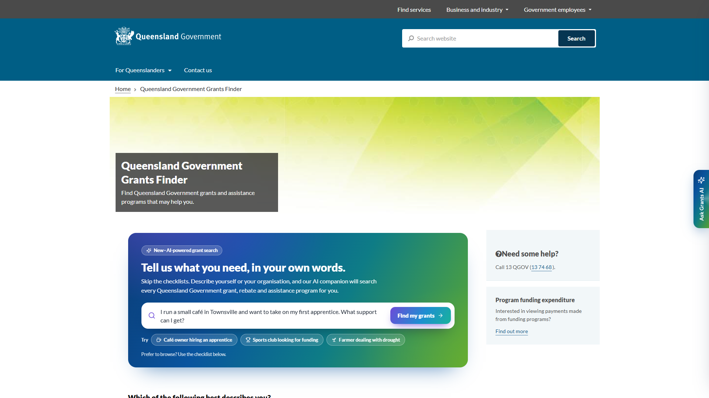
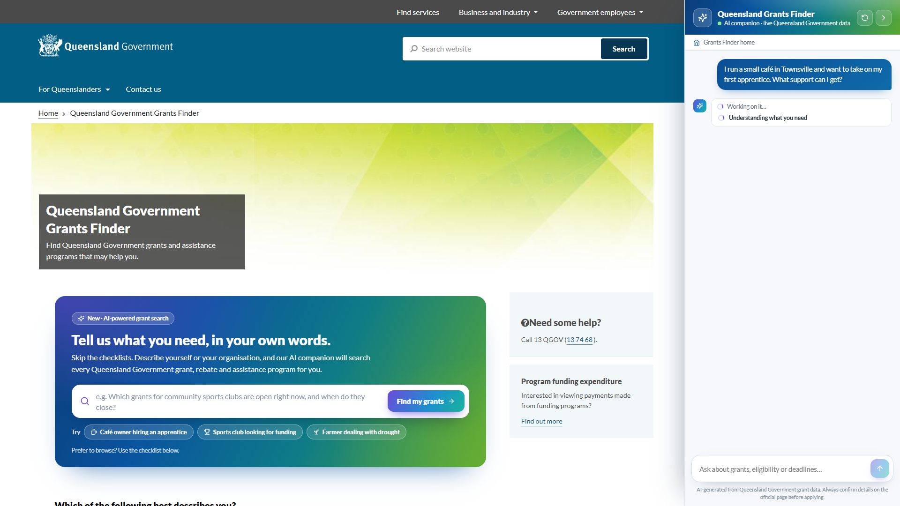
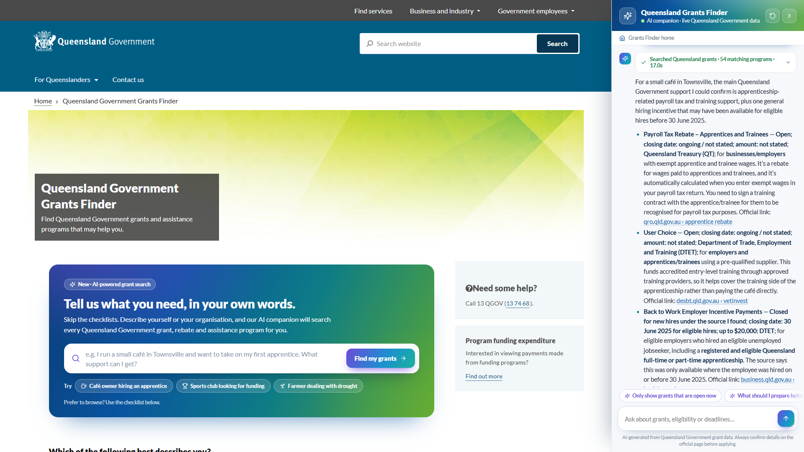
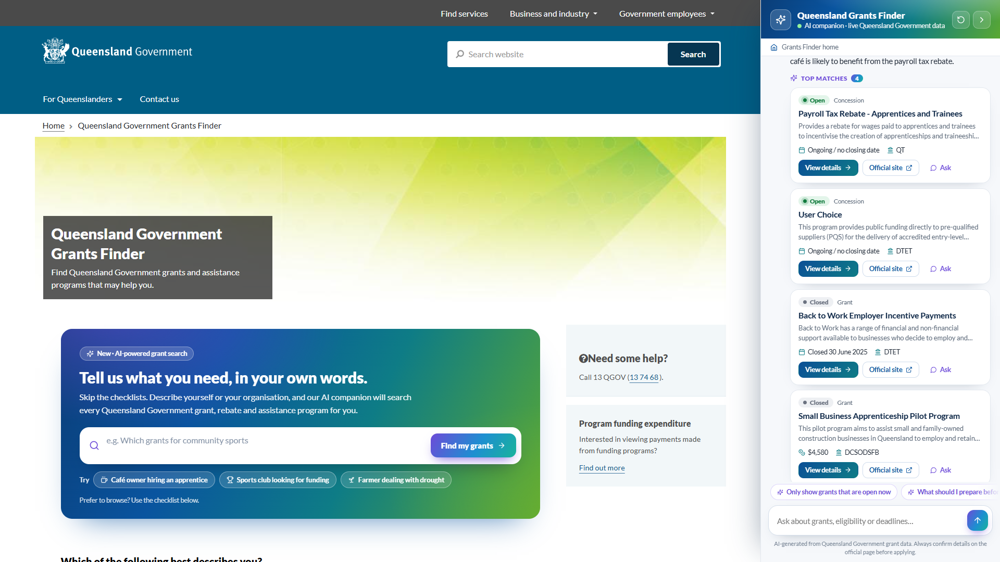
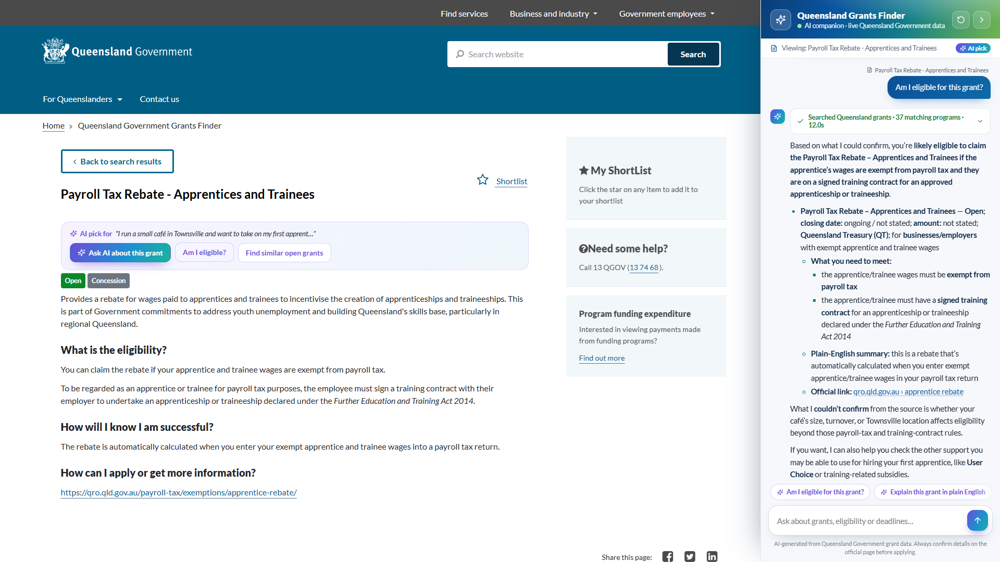
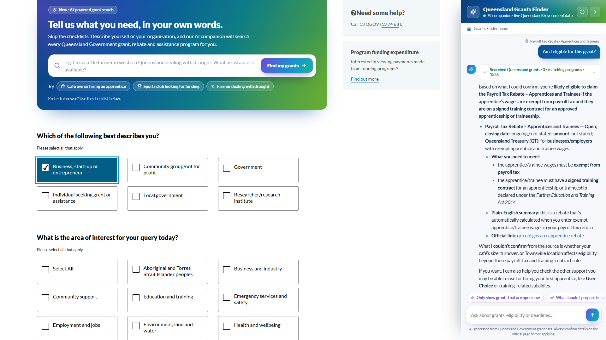
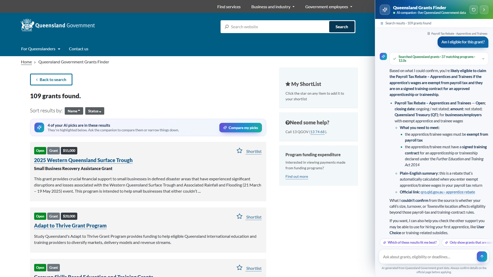
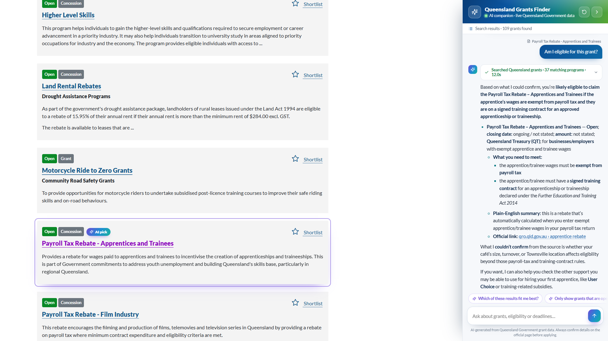
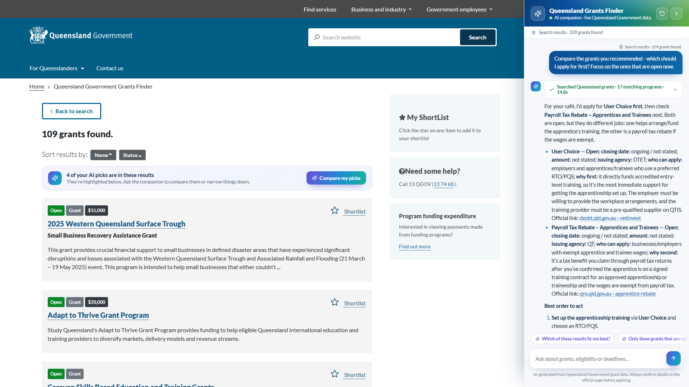
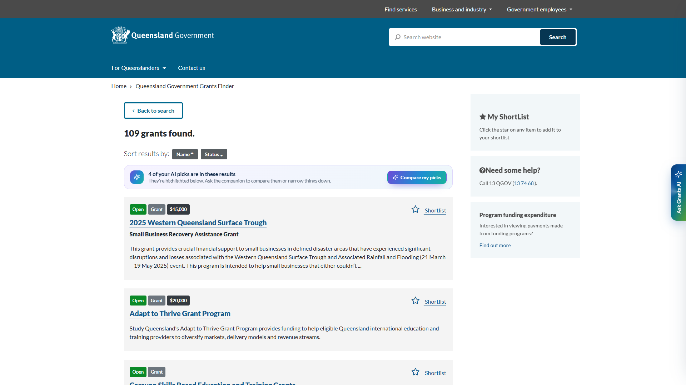

# The next-gen Grants Finder journey

> A concept walkthrough of the [Grants Finder AI Companion](README.md) running on the live
> [Queensland Government Grants Finder](https://www.grants.services.qld.gov.au/). Every answer below is real. It was
> produced by our Microsoft Foundry agent, grounded in the FoundryIQ grants index.

**Persona - Mia, owner of a small café in Townsville.** Business is picking up and she wants to take on her
**first apprentice**. She has heard "there's government support for that", but doesn't know program names,
which agency runs them, or which filters to tick.

| | Today | With the AI companion |
| --- | --- | --- |
| **Starting point** | A checklist of applicant types and areas of interest | Describe your situation in plain English |
| **Finding programs** | Scan 100+ results, open each one | A grounded shortlist with status, dates, agency and links |
| **Understanding fit** | Read eligibility text and interpret it alone | "Am I eligible?" answered in context, including what is still unknown |
| **Deciding** | Compare tabs by hand | "Which should I apply for first?" gives a prioritised plan |
| **Continuity** | Every page starts from scratch | The companion follows you across pages and remembers the conversation |

---

## 1. A front door that speaks human

Mia lands on the Grants Finder. Above the familiar checklist there is now an **AI-powered grant search**. Its
placeholder types out example requests, and starter chips show the kinds of things she can ask.

## 2. Ask in plain English

She doesn't need to know that apprenticeship support is split across a payroll tax concession, a training subsidy
and a travel subsidy, run by two different agencies. She just says what she is trying to do.

## 3. The companion slides in and shows its work

The companion docks to the right, and the site reflows beside it so nothing is covered. A **live trace** shows
each step as it happens: *understanding what you need*, then *searching Queensland Government grants* (with the
exact query the agent wrote), then *writing your answer*. Transparency builds trust before a single word of the
answer appears.

## 4. A grounded answer, with official links

The answer streams in. It covers each relevant program with its **status**, **closing date**, **amount**,
**issuing agency** and a link to the official page. All of it comes from the grants index, not the model's memory.
The agent also says what it *couldn't* confirm.

## 5. Top matches as actionable cards

Below the answer, the programs it recommended become **rich cards**, with open programs first. Each card offers
**View details** (in-site navigation), **Official site**, or **Ask** (a follow-up about that grant).

## 6. The conversation follows her across the site

Mia clicks **View details**. The Grants Finder navigates to the program page as usual, and the companion stays
exactly where it was. The page now has an **AI bar** that remembers *why* this grant was recommended, with
one-click questions about this specific program. The panel's context strip also shows what she is viewing.

## 7. "Am I eligible?" - answered in context

Because the companion knows which page she is on, a one-word question just works. The answer is honest. It sets
out what the program requires, what it could confirm, what it couldn't (for example, whether her café's wages are
payroll-tax exempt), and the practical next step.

## 8. The classic path still works

Mia's accountant prefers the original filters, so she ticks **Business, start-up or entrepreneur** and shows the
results. The existing experience is untouched; the AI simply layers on top.

## 9. AI insights on the site's own results

On the results page, an **insights bar** tells her how many of her AI picks are in this list, with a one-click
**Compare my picks**.

## 10. Recommended programs stand out

As she scrolls, the programs the companion recommended carry an **AI pick** badge and a soft highlight. The
conversation and the classic browsing experience now reinforce each other.

## 11. From options to a plan

"Which should I apply for first?" The companion compares its own recommendations for *her* situation and returns
a prioritised plan. For each program it gives the reason for its place in the order and the official link.

## 12. Out of the way when she doesn't need it

One click tucks the companion into a glowing edge tab (or press **Alt+G**). The page gets its full width back, and
the whole conversation is still there when she returns - even after closing the tab.

---

## Why this matters

- **Minutes, not hours.** Mia went from "I think there's something for apprentices" to a grounded, prioritised
  plan with official links in about three questions.
- **Meets people where they are.** It works for plain-language askers and checklist browsers alike, on the same site.
- **Trustworthy by design.** Answers come only from Queensland Government grant data. The UI shows its work, states
  what is unknown, and always links to the official source.
- **Additive, not a rebuild.** Everything here is layered onto the existing public site by an extension. The same
  agent could be embedded natively in the Grants Finder, in a Teams or Microsoft 365 Copilot agent, or on a contact-centre desktop.

## Under the hood

- The Grants Finder pages are unchanged. A Manifest V3 extension adds the UI in Shadow DOM.
- A Microsoft Foundry **prompt agent** (`qld-grants-agent`, `gpt-5.4-mini`) grounds its answers with a **FoundryIQ
  knowledge base** over the Azure AI Search `grants` index.
- The index is hybrid (keyword + vector + semantic) and is refreshed weekly by the Azure Function indexer in this repo.
- Setup and architecture are in [README.md](README.md). The walkthrough video is produced by `npm run capture` and
  is kept out of git.
