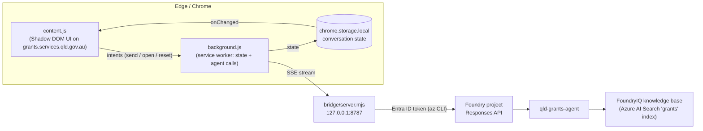

# Grants Finder AI Companion (demo extension)

> **Throwaway, art-of-the-possible demo.** An Edge/Chrome extension that overlays an AI companion on the public
> [Queensland Government Grants Finder](https://www.grants.services.qld.gov.au/). The companion talks to our
> Microsoft Foundry grants agent (`qld-grants-agent`). This is not an official Queensland Government product.

**See the walkthrough: [JOURNEY.md](JOURNEY.md)** - the next-gen user journey, with 16:9 screenshots.


## What it does

| Where | What the extension adds |
| --- | --- |
| **Landing page** | An AI hero card ("Tell us what you need, in your own words") with a live-typing placeholder and three starter prompts. It sits above the site's existing checklist. |
| **Everywhere** | A docked companion panel (Alt+G). It shows a live trace of the agent's work (understand, search, write), a streamed markdown answer, and **Top matches** cards. Each card has *View details*, *Official site* and *Ask* buttons. When closed, it becomes a glowing edge tab. |
| **Results page** | An insights bar ("3 of your AI picks are in these results") with a *Compare my picks* action. It also adds **AI pick** badges and highlights on the site's own result cards. |
| **Detail page** | An inline AI bar under the title with *Ask AI about this grant*, *Am I eligible?* and *Find similar open grants*. It also shows why the AI recommended the grant ("AI pick for 'I run a small café…'"). |

The conversation **persists across page changes**, full reloads and tabs. Card links use the site's own Vue router
(`history.pushState` + `popstate`), so moving between pages feels instant.

## Architecture



- **No coupling with the agent code.** Everything lives in this folder. The extension only calls the public
  Foundry Responses API through the bridge, and pins the published agent by name.
- **No secrets in the extension.** The zero-dependency bridge gets a short-lived token from `az account get-access-token`
  and relays only three routes (`/health`, `/v1/conversations`, `/v1/responses`). It listens on `127.0.0.1` and only accepts
  extension origins.
- **The service worker does all network I/O.** This avoids page CORS and Local Network Access prompts. Content scripts
  only render state from `chrome.storage`, which is why the chat survives navigation.
- **Compact memory.** Each question runs in a fresh Foundry conversation, seeded with a short recap of earlier turns
  (the questions, the picks and their status). Replaying full server-side history, including every retrieval payload,
  quickly exceeds the model deployment's tokens-per-minute quota. Rate-limit errors are retried automatically with a
  visible countdown.
- **Grant cards come from the retrieval, not the prose.** The worker parses the `mcp_call` output of the knowledge base
  (id, title, status, dates, agency, url). It then keeps the grants the answer actually mentions (open programs first).

## Run it

Prerequisites: Node 20+, Azure CLI signed in (`az login`) with the *Azure AI User* role on the Foundry project, and Edge or Chrome.

```powershell
cd demo/grants-finder-extension
npm install

# 1. Start the local agent bridge (leave it running)
$env:FOUNDRY_PROJECT_ENDPOINT = "https://<account>.services.ai.azure.com/api/projects/<project>"
npm run bridge
```

| Bridge env var | Default | Purpose |
| --- | --- | --- |
| `FOUNDRY_PROJECT_ENDPOINT` | *(required)* | Foundry project endpoint (`azd env get-value` / deployment output) |
| `AGENT_NAME` | `qld-grants-agent` | Published agent to talk to |
| `PORT` | `8787` | Local port (update the extension options if you change it) |

2. Load the extension:
   - Open `edge://extensions` (or `chrome://extensions`).
   - Turn on **Developer mode**.
   - Click **Load unpacked** and select `demo/grants-finder-extension/extension`.
3. Open <https://www.grants.services.qld.gov.au/>. Use the AI hero, the edge tab, the toolbar icon, or **Alt+G**.

The options page (right-click the toolbar icon, then **Extension options**) sets the bridge URL, tests the connection
and clears the conversation.

## Re-record the journey

`tools/capture.mjs` drives the whole journey with Playwright, using the unpacked extension in headless Chromium at
1920x1080. It adds a fake cursor, click ripples and captions (these exist only in the capture tool, not in the
extension). It then:

- saves the 12 screenshots to `screenshots/`
- encodes an H.264 MP4 to `recordings/` (git-ignored). The slow agent searches are fast-forwarded 5x.

```powershell
npm run bridge            # in another terminal
npm run capture           # screenshots + recordings/grants-ai-companion-journey.mp4
npm run capture -- --no-video
```

Video encoding uses `ffmpeg-static`, which is an optional dependency. On Windows ARM64 it also works with the x64
binary: `$env:npm_config_arch='x64'; npm i`. If neither `ffmpeg-static` nor an `ffmpeg` on `PATH` is available,
the tool falls back to Playwright's bundled ffmpeg and writes a VP8 WebM instead.

## Files

```
extension/
  manifest.json      MV3 manifest (storage permission, grants site + localhost only)
  background.js      service worker: agent calls, SSE parsing, state, picks, rate-limit retries
  content.js         all on-page UI (companion panel, hero, results bar, detail bar, AI-pick badges)
  panel.css          Shadow DOM styles
  lib/grants.js      parse retrieved grants from the knowledge-base tool output; match them to the answer
  lib/markdown.js    small, safe DOM markdown renderer (no innerHTML for model text)
  options.html/.js   bridge URL, connection test, clear conversation
bridge/server.mjs    local auth relay to the Foundry Responses API
tools/capture.mjs    scripted journey: screenshots + MP4
tools/icons.mjs      regenerates the toolbar icons
```

## Limitations

- **Demo only.** It depends on the Grants Finder's current DOM and routes (`/`, `/results`, `/service-details/:id`), so
  a site redesign will break the decorations. The chat panel will keep working.
- **Answers are AI-generated** from the indexed grants data and can be incomplete. The UI always links to the official page.
- **Answers take 10-30 seconds**, mostly on the knowledge-base search. The `gpt-5.4-mini` deployment's TPM quota is the
  main constraint when several people use it at once.
- **The bridge is for local demos only.** A real deployment would put an authenticated backend (e.g. an Azure Function
  with Entra ID) in front of the agent.
